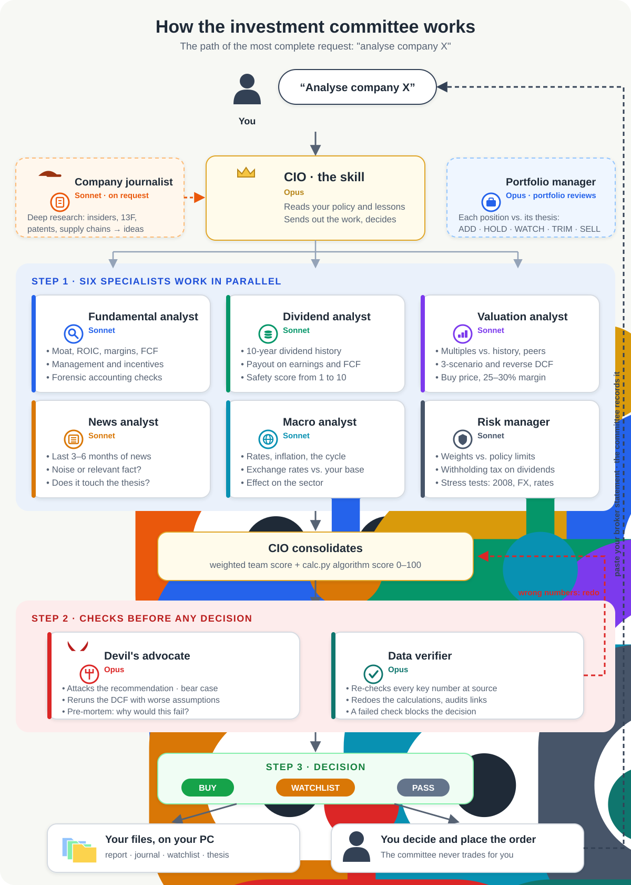

# investment-committee

**A personal AI investment committee for [Claude Code](https://claude.com/claude-code).** A CIO skill coordinates 10 specialist agents to analyse companies, review your portfolio and plan monthly investments, following a long-term, Buffett/Munger-style philosophy. It is a decision framework, not a trading bot: no short-term signals, no order execution.

> [!CAUTION]
> **Not financial advice.** This project is for educational and research purposes only. The authors accept no responsibility for financial losses. AI agents make mistakes, including with numbers and sources. Never act on its output without checking the data and deciding for yourself.

- **No frameworks.** No LangChain, CrewAI or custom backend: just Claude Code, Markdown instructions and one standard-library Python calculator.
- **Local-first.** Your portfolio, transactions and journal are plain `.csv` and `.md` files on your computer. Nothing is uploaded anywhere except the web searches the agents make.
- **Checks and balances.** A devil's advocate attacks every recommendation, and a data verifier re-checks the decisive numbers in primary sources and can block a decision.
- **Human in the loop.** The committee recommends; you decide and place the orders with your broker.

## How it works

The CIO is the skill itself: it reads your request, sends the work to the specialists, combines their answers and decides. This is the path of the most complete request, *"analyse company X"*:



Agents work in a star: each specialist reports to the CIO, never to each other. Memory between sessions lives in your files (theses, journal, watchlist, approved lessons). `calc.py` does every calculation that must be exact (DCF, reverse DCF, scoring algorithm, risk limits, consistency checks), so numbers don't depend on the model's mental arithmetic.

### The team

| Agent | What it does | Model |
|---|---|---|
| CIO (the skill) | Splits the work, combines the opinions, makes the final decision and keeps the files consistent | Opus |
| `fundamental-analyst` | Is this an excellent business to own for 10 years? Moat, ROIC, margins, FCF, owner earnings, management incentives, forensic accounting | Sonnet |
| `dividend-analyst` | Is the dividend safe and growing? 10-year history, payout on earnings and FCF, cut risk, safety score 1–10 | Sonnet |
| `valuation-analyst` | What is it worth? Multiples vs. history and peers, 3-scenario DCF, reverse DCF, base rates, buy price with a 25–30% margin of safety | Sonnet |
| `news-analyst` | Did anything in the last 3–6 months change the 10-year value? Separates noise from relevant facts | Sonnet |
| `macro-analyst` | How rates, inflation, the cycle and exchange rates help or hurt the sector over the long term | Sonnet |
| `risk-manager` | Weights by company, sector, country and currency vs. your policy limits, withholding tax, stress tests (2008, currency +20%, rates +2 points) | Sonnet |
| `portfolio-manager` | Compares each position with its thesis: ADD / HOLD / WATCH / REVIEW THESIS / TRIM / SELL | Opus |
| `devils-advocate` | Attacks the recommendation: best bear case, weak assumptions, the committee's biases, pre-mortem | Opus |
| `data-verifier` | Confirms every decisive number in primary sources, redoes the calculations, audits citations; a ❌ verdict blocks the decision | Opus |
| `company-journalist` | Deep research (insiders, 13F, supply chains, patents, regulators, job postings): hidden gems, catalysts, alerts, paradigm shifts. Forwards ideas, never recommends | Sonnet |

### What you can ask

| You say | What happens |
|---|---|
| *"analyse company X"* | The full path in the diagram. Ends in BUY, WATCHLIST or PASS, with a buy price and the DCF command that produced it |
| *"review my portfolio"* | Risk, valuation, macro and news on every position; the portfolio manager gives one decision per position; the checks attack anything that is not HOLD |
| *"I have 1000 EUR to invest"* | Splits the money by your policy, compares candidates below their buy price, checks the risk limits; whatever no stock deserves goes to your core ETF |
| *"find ideas"* | Quality dividend candidates split into SAFE / MODERATE / AGGRESSIVE; the ones that pass go to the watchlist |
| *"journalist, find ideas"* | The journalist's deep research; you choose which ideas go on to a full analysis |
| *"I bought…"* / a broker statement | Records the movements in your files and checks they agree with each other |
| *"check alerts"* | Watchlist and positions below or near their buy price, and earnings dates in the next 14 days |
| *"review X's results"* | Results vs. the expectations written beforehand; the buy price changes only if the business changed |
| *"do the review"* · *"tax report 2026"* · *"annual letter"* · *"show the dashboard"* | Periodic workflows: past decisions vs. outcomes and vs. the benchmark, tax tables, a Buffett-style letter, a dashboard |

## Requirements

- **Claude Code** with a paid plan (Claude subscription or API). See [claude.com/claude-code](https://claude.com/claude-code).
- Python 3.12 or newer (standard library only).
- **Cost:** a full company analysis runs 8 agents, several on Opus, with many web searches. It uses a lot of tokens. Watch your usage, especially if you schedule the journalist.

## Install

```bash
git clone https://github.com/tycoon2323/investment-committee
cd investment-committee
cp -r skills/investment-committee ~/.claude/skills/
cp agents/*.md ~/.claude/agents/
mkdir -p ~/investment-committee
cp -rn skills/investment-committee/example-data/. ~/investment-committee/   # your private data folder; never overwrites existing files
```

On Windows, run these commands in Git Bash (it comes with Git for Windows, which Claude Code uses) or WSL.

Then edit `~/investment-committee/policy.md` (your investment policy: base currency, country, limits) and ask Claude Code, for example: *"analyse company Nestlé"*, *"review my portfolio"*, *"I have 1000 EUR to invest"*, *"journalist, find ideas"*.

> Works for any country: set your **base currency** and **country of residence** in `policy.md`, and the committee applies your country's tax rules and benchmark (Swiss and US rules appear in the files only as examples). The committee answers in your language.

Your data stays in `~/investment-committee/` on your computer. Never commit it.

## Make it yours

`skills/investment-committee/philosophy.md` is the committee's philosophy: what counts as a quality business, the margin of safety, which sources to trust. It is the part most worth adapting. A growth investor or a strict value investor can rewrite it, and every agent follows the new rules. Your personal policy (core ETF share, risk limits, costs) goes in `policy.md`, which only you change.

## What a decision looks like

An illustrative, shortened example for a fictional company:

```text
CIO, provisional: BUY EXMP below 48 USD (team score 7.4/10, algorithm 71/100)

Devil's advocate: holds, with caveats
- The DCF assumes 9%/yr FCF growth; the 10-year history is 6%. At 6%,
  intrinsic value falls from 64 to 55 and the margin of safety from 25% to 13%.
- Top customer is 22% of revenue (annual report, note 4).
Pre-mortem: customer loss (25%), price war (15%), failed acquisition (10%).

Data verifier: ⚠️ approved with corrections
- FCF 2025: analyst used 412 M; 10-K shows 398 M (capex restated). Recalculated.

CIO, final: WATCHLIST, buy price lowered to 44 USD (dcf command saved)
```

## What's inside

| Path | What |
|---|---|
| `skills/investment-committee/SKILL.md` | The CIO: workflows and rules |
| `skills/investment-committee/philosophy.md` | Philosophy and rules every agent follows |
| `skills/investment-committee/calc.py` | Calculator (DCF, reverse DCF, scoring algorithm, risk, performance). Standard library only; `python calc.py test` runs the self-tests |
| `skills/investment-committee/references/` | Algorithm detail, data rules (transactions, splits, quotes), periodic workflows (review, tax, annual letter, dashboard), templates |
| `skills/investment-committee/example-data/` | Empty data templates (portfolio, transactions, watchlist, journal…); the CIO copies missing ones on first run |
| `agents/` | The 10 specialist agents: fundamental, dividends, valuation, news, macro, risk, portfolio manager, devil's advocate, data verifier and company journalist |

## Ideas for contributions

- Country-specific tax agents (e.g. Portugal, Germany) or a tax-report template for your country
- New specialists (ESG, credit, sector experts)
- Better valuation models or scoring weights in `calc.py`
- Translations of the instructions

## Contributing

Found a mistake by an agent, or a rule that should change? Open an Issue. Improvements to agents, rules or `calc.py` are welcome as Pull Requests. Run `python skills/investment-committee/calc.py test` before sending. Never include personal portfolio data.

## License

MIT
